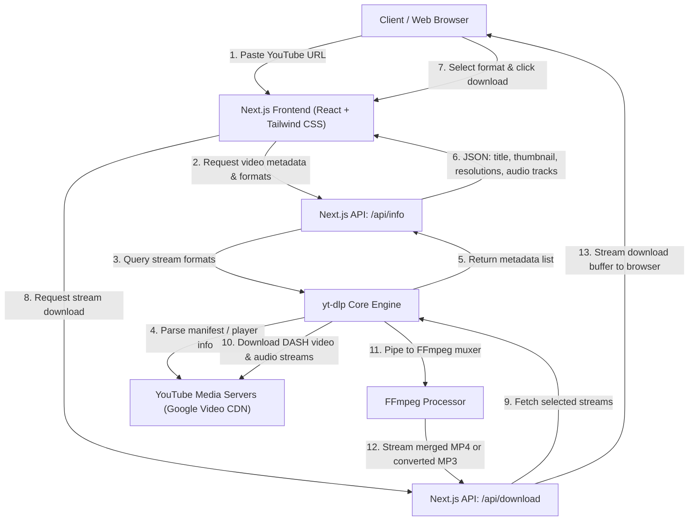

# YouTube Downloader Application Architecture

## 1. System Overview

This application is a full-stack web platform built on Next.js that allows users to input any YouTube video URL, inspect available streams, and download high-definition video (up to 4K) or standalone audio (MP3/M4A).

---

## 2. Core Architecture Layers

### A. Presentation Layer (Frontend)
* **Framework:** Next.js (App Router) + React
* **Styling:** Tailwind CSS
* **Components:**
  * **LinkInputForm:** URL parsing, clipboard paste handler, input validation.
  * **VideoPreviewCard:** Displays video thumbnail, title, channel name, duration, and view count.
  * **FormatSelectorTabs:**
    * **Video Tab:** Resolution options (2160p / 4K, 1440p / 2K, 1080p / FHD, 720p / HD, 480p, 360p) with container details (MP4) and estimated file size.
    * **Audio Tab:** Bitrate options (320 kbps, 256 kbps, 192 kbps, 128 kbps) with format options (MP3, M4A).
  * **ProgressBar / StatusIndicator:** Real-time feedback during format probing, downloading, and muxing.

---

### B. Application & API Layer (Backend)
* **Runtime:** Node.js server runtime in Next.js Route Handlers.
* **Endpoints:**
  1. `POST /api/info`
     * **Input:** `{ url: string }`
     * **Process:** Calls `yt-dlp --dump-json` to extract video details without downloading media chunks.
     * **Output:** JSON containing video title, duration, thumbnail URL, and available video/audio format streams.
  2. `GET /api/download`
     * **Input Query:** `?url=<URL>&format_id=<ID>&type=<video|audio>&quality=<res|bitrate>`
     * **Process:** Spawns `yt-dlp` process configured with format selection flags and pipes output directly through `ffmpeg` into the HTTP response stream.
     * **Headers:** `Content-Disposition: attachment; filename="<title>.<ext>"`, `Content-Type: video/mp4` or `audio/mpeg`.

---

### C. Media Extraction & Processing Engine
* **`yt-dlp`:**
  * Extracts DASH manifests and direct HTTP streaming URLs.
  * Handles YouTube signature deciphering and bypasses YouTube format restrictions.
* **`ffmpeg`:**
  * **Video Merging (1080p+):** Combines the selected video-only DASH stream with the highest quality audio stream without quality re-encoding (`-c:v copy -c:a aac`).
  * **Audio Extraction:** Extracts audio stream and converts to MP3 or M4A container with desired bitrate (`-vn -b:a <bitrate>k`).

---

## 3. Data Flow & Format Selection Logic

| Request Type | Source from YouTube | Processing Step | Target Output |
| :--- | :--- | :--- | :--- |
| **Audio (MP3)** | Best Audio Stream (Opus/M4A) | FFmpeg converts to MP3 with specified bitrate | `.mp3` file |
| **Audio (M4A)** | AAC/M4A Stream | Direct stream copy without re-encoding | `.m4a` file |
| **Video (<= 720p)** | Pre-muxed Progressive Stream (if available) | Direct stream copy | `.mp4` file |
| **Video (1080p - 4K)** | DASH Video Stream + DASH Audio Stream | FFmpeg muxes both into standard MP4 container | `.mp4` file |

---

## 4. Environment & Deployment Strategy

* **Local Development:**
  * Requires `yt-dlp` and `ffmpeg` installed on the host system or placed in project binary path.
* **Production Deployment:**
  * Dockerized container deployment (Node.js + Linux + FFmpeg + yt-dlp) on VPS (e.g., Docker on Railway, DigitalOcean, Hetzner, or AWS EC2).
  * *Note:* Standard serverless environments (Vercel serverless) have execution time limits and shared IP ranges often rate-limited by YouTube bot detection; a containerized instance or dedicated worker is the standard solution.

